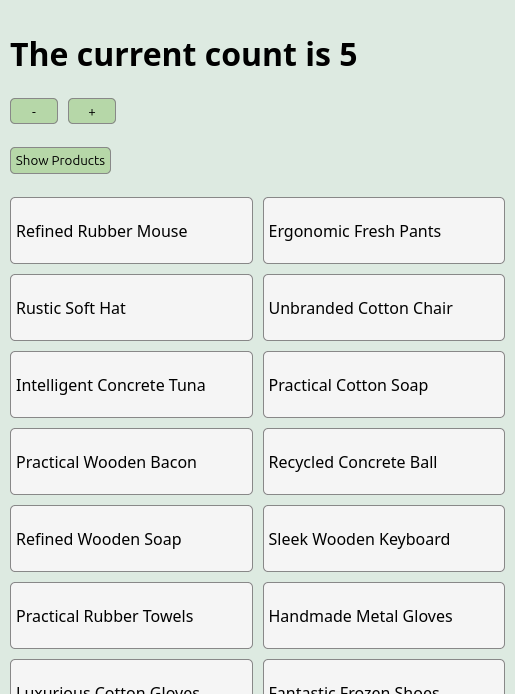

# Intro
This is one of the many projects I had to do at scrimba's frontend course.
It's about learning react performance and the project aims to teach me the basics of react performance.
The app is about showcasing how you can load something while you are waiting for your data to be returned(useful for slow internet connections)



# Run it
Install the dependencies and run the project
```
npm install
npm start
```
OR
Try it at [https://react-suspense-expp.netlify.app/](https://react-suspense-expp.netlify.app/)