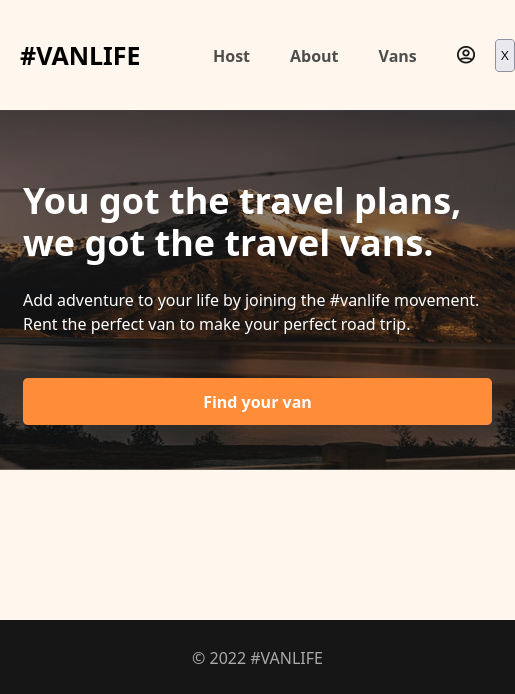
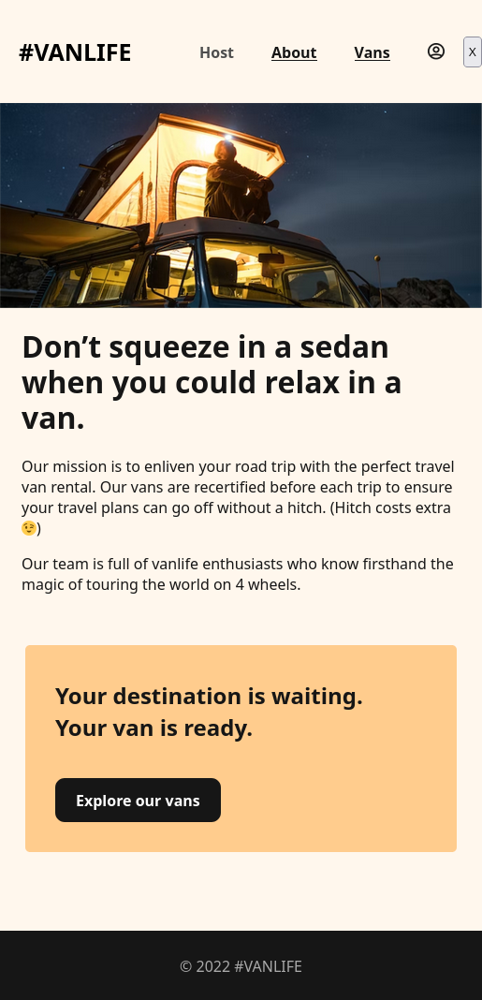
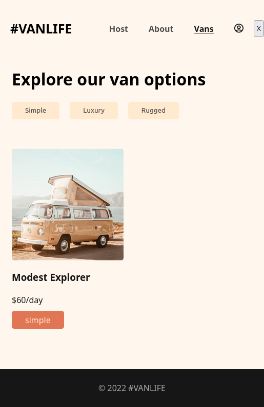

# Intro
This is one of the many projects I had to do at scrimba's frontend course.
It's about learning react and the project aims to teach me the basics of react router.
The app is about showcasing what you can do with react router and firebase.






# Run it
Install the dependencies and run the project
```
npm install
npm start
```
OR
Try it at [https://react-vanlife-expp.netlify.app/](https://react-vanlife-expp.netlify.app/)